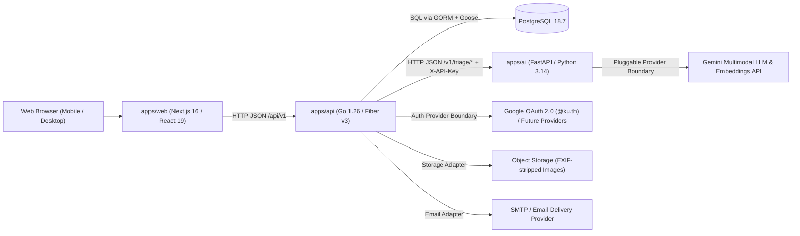

# KU Spot — System Architecture & Technical Specification

This document defines the service topology, Go modular monolith boundaries, authentication/session strategy, media/EXIF pipeline, AI triage integration, background jobs, and error handling conventions for **KU Spot**.

---

## 1. System Topology



### Service Responsibilities

| Service | Owns | Must Never Do |
| --- | --- | --- |
| **`apps/web`** | UI rendering, public/authenticated routes, interactive Leaflet campus map, client validation, `/api/health` readiness proxy. | Connect directly to PostgreSQL or AI Gateway; enforce security/Separation-of-Duties client-side only; expose PII on public pages. |
| **`apps/api`** | System of Record, authentication & session management, RBAC & Separation of Duties, state machines, EXIF stripping, media storage orchestration, candidate shortlisting for AI, audit logging, retention jobs, email dispatch, analytics queries. | Run `gorm.AutoMigrate`; allow AI failure to fail report submission; expose private fields in public DTOs. |
| **`apps/ai`** | Stateless pluggable AI Triage & Embedding Gateway (`contracts/ai-triage.v1.yaml`): optional report rephrasing, multimodal category classification, deterministic severity, keyword extraction, report/ticket embedding vectors, and multi-report Ticket synthesis. | Connect directly to PostgreSQL; mutate operational Tickets/Reports; auto-confirm/reject/resolve; auto-upgrade severity purely from report count. |

---

## 2. Go API Modular Monolith (`apps/api`)

Business capabilities live under `apps/api/internal/modules/<module-name>/` with clean hexagonal layers:

```text
internal/modules/<module-name>/
├── domain/                   # Pure Go: entities, value objects, state machines, domain errors (0 framework imports)
├── application/              # Use cases, transaction coordination, consumer-defined repository/port interfaces
└── adapters/
    ├── inbound/http/         # Fiber v3 handlers, request DTO validation, domain-error -> HTTP mapping
    └── outbound/postgres/    # GORM persistence models & domain mappers
```

### Canonical Module Map

| Module | Owned Responsibilities | Key Tables |
| --- | --- | --- |
| `identity` | Auth callback, session issuance/validation, user provisioning, Username updates (`UC-AUTH-001`, `UC-USR-001`), Admin user/role management (`UC-ADM-001`). | `users`, `user_roles`, `sessions` |
| `masterdata` | Categories, Departments, Campus Locations CRUD & soft-disable (`UC-ADM-002`..`004`). | `categories`, `departments`, `campus_locations` |
| `media` | Upload validation (`.png`/`.jpg`/`.jpeg`, ≤10 MB, 1–5/report), EXIF stripping, object storage adapter, signed/public serving, purge cleanup. | `report_images`, `activity_evidence_images` |
| `reports` | Draft save/resume, Report submission, Pending edit (`version++`), Cancel, AI analysis orchestration & storage (`UC-RPT-001`..`005`, `UC-AI-001`..`002`). | `reports`, `ai_analysis_runs`, `ticket_candidates` |
| `review` | Incoming queue, optimistic-lock Confirm (Existing/New Ticket), Reject with reason, Confirmed Report correction, Ticket AI re-evaluation approval (`UC-REV-001`..`005`, `UC-AI-003`). | Coordinates `reports` + `tickets` |
| `tickets` | Public Feed/Search/Filter/Map, Ticket Detail, Status transitions (`Start`, `Resume`), Multi-Department management & completion, Auto-`RESOLVED`, Public Activity Timeline, `Mark Affected` (`UC-PUB-*`, `UC-MAP-001`, `UC-DEP-001`..`003`, `UC-TKT-001`..`004`, `UC-REV-006`, `UC-AFF-001`). | `tickets`, `ticket_department_assignments`, `ticket_ai_reevaluations`, `ticket_affected_users`, `public_activity_events` |
| `threads` | Private Additional Information Thread (`UC-THR-001`, `UC-THR-002`) with strict participant authorization. | `thread_messages` |
| `feedback` | Multi-dimensional Feedback submission, editing, and aggregate calculation (`UC-FBK-001`, `UC-FBK-002`). | `feedback_submissions` |
| `analytics` | System-wide and Department-scoped KPI & time-metric read models (`UC-ADM-005`, `UC-DEP-004`). | Read-only SQL queries across core tables |
| `audit` | Append-only audit log writer & query port (`BR-AUD-003`..`009`). | `audit_logs` |
| `notifications` | Major Event Email formatting, recipient resolution (Reporters only), delivery log (`UC-NOT-001`). | `email_notification_logs` |

### Cross-Module Interaction Rules

* Wire all module constructors explicitly in `internal/bootstrap/`.
* Modules communicate across boundaries via narrow Go interfaces (application ports) or shared transaction helpers — **never** by importing another module's `adapters/outbound/postgres/` GORM structs.
* Multi-entity mutations (e.g., Confirm Report → Create/Attach Ticket → Append Public Activity → Append Audit Log) execute inside a single PostgreSQL transaction.
* **Ticket-Level Row Locking (`SELECT ... FOR UPDATE`):** Because PostgreSQL defaults to `READ COMMITTED`, any transaction that modifies a Ticket's status, Responsible Departments (`UC-REV-006`, re-evaluation apply), department completion (`UC-DEP-003`), or `reevaluation_revision` (`UC-REV-002`, `UC-REV-005`) MUST first acquire a row lock on the target Ticket (`SELECT ... FROM tickets WHERE id = $1 FOR UPDATE`). This serializes concurrent requests on the same Ticket, guarantees that simultaneous department completions or removals always observe the prior committed update and trigger Auto-`RESOLVED` (`BR-DEP-003`, `BR-DEP-007`), and ensures `AUTO_RESOLVED` activity + `RESOLVED` email are emitted **at most once**.

---

## 3. Authentication, Sessions & Authorization

* **Pluggable Provider Boundary (`BR-AUTH-001`, `BR-AUTH-004`):** Define the `AuthProvider` port in identity application and implement it in `internal/adapters/auth/` returning normalized external identity claims (`provider`, `provider_subject_id`, `email`, `email_verified`, `hosted_domain`, `real_name`, `avatar_url`).
  * **Initial MVP Provider:** **Google OAuth 2.0** restricted to `@ku.th` (`hosted_domain == "ku.th"`).
  * **Future Extensibility:** Designed behind the `AuthProvider` port so additional providers (such as KU-ALL SSO or another OIDC/SAML provider) can be plugged in with zero changes to `domain/` or business modules.
* **Session Transport:** HTTP-only, `Secure` (in production), `SameSite=Lax` signed session cookie managed by `apps/api` (proxied or same-site with `apps/web`). The database stores only the token hash, checks expiry and revocation, and loads current access for every authenticated request. Public read routes ignore missing cookies. Write and private routes require a valid active session. See [ADR 0003](decisions/0003-identity-session-and-auth-provider.md).
* **Defense-in-Depth RBAC & Separation of Duties:**
  1. HTTP middleware enforces authentication and coarse role membership.
  2. Application/Domain layer enforces resource-level invariants:
     * `ADMINISTRATOR` is exclusive (`len(roles) == 1`, `department_id == nil`) and blocked from operational actions (`BR-ROLE-002`, `BR-ROLE-007`).
     * `DEPARTMENT_STAFF` has exactly one `department_id` and may act only on Tickets assigned to that department (`BR-ROLE-003`).
     * **Separation of Duties (`BR-ROLE-004`, `BR-ROLE-005`):** Before any Reviewer or Department operational action, verify `actor.id != report.reporter_id` (for Reports) and `actor.id NOT IN (SELECT reporter_id FROM reports WHERE ticket_id = :ticketId AND status = 'CONFIRMED')` (for Tickets).

---

## 4. Media Upload, Storage & EXIF Stripping

* **Constraints (`BR-RPT-003`..`005`):** `1–5` images required at submission; each file `≤ 10 MB`; accept only verified PNG/JPEG magic bytes (`.png`, `.jpg`, `.jpeg`). No video files in MVP.
* **EXIF Stripping:** `apps/api` decodes and re-encodes (or strips metadata segments from) every uploaded JPEG/PNG image **before** persisting to object storage so GPS, camera model, timestamps, and author metadata never reach storage or public responses.
* **Staged Upload & Transactional Binding Lifecycle:**
  1. `POST /api/v1/media/report-images` validates format/size, strips EXIF, writes the object to storage, and inserts a staged `report_images` row with `report_id = NULL`, `uploaded_by = actor.id`, and `expires_at = NOW() + 24 hours`.
  2. While `report_id IS NULL`, only `uploaded_by` may read/preview the image (`GET /api/v1/media/report-images/:imageId`); all others receive `403`/`404`.
  3. On Draft save/update (`POST/PATCH /reports/drafts`), direct submit (`POST /reports`), Draft submit (`POST /reports/:id/submit`), or Pending edit (`PATCH /reports/:id`), `apps/api` verifies inside the **same SQL transaction** that every referenced `imageId` belongs to `actor.id` AND is either staged (`report_id IS NULL` and not expired) or already attached to that same `report.id`, then binds `report_id = report.id`, sets `sort_order`, and clears `expires_at = NULL`.
  4. Once attached, image read authorization inherits the parent Report's visibility (`DRAFT`/`CANCELLED`: owner only; `PENDING_REVIEW`/`REJECTED`: owner + active `REVIEWER`; `CONFIRMED`: Public).
* **Storage Adapter (`internal/adapters/storage/`):** Abstract behind an `ObjectStore` port (local disk volume for dev/compose, S3-compatible / MinIO for staging/production).
* **Purge Cleanup:**
  * Daily (or hourly) cleanup deletes expired staged images (`report_id IS NULL AND expires_at <= NOW()`) and removes their storage objects.
  * When the 30-day retention job purges `DRAFT` or `CANCELLED` Reports (`BR-RET-001`..`002`), delete orphaned media objects asynchronously after DB deletion commits.

---

## 5. AI Triage & Re-evaluation Pipeline (`apps/api` ↔ `apps/ai`)

Canonical OpenAPI schema: [contracts/ai-triage.v1.yaml](../contracts/ai-triage.v1.yaml). Integration rules: [contracts/ai-gateway.md](../contracts/ai-gateway.md).

1. **Bounded Timeout & Non-Blocking Submit (`BR-GEN-008`, `BR-AI-020`):**
   * `POST /reports/:id/submit` persists `PENDING_REVIEW` first in PostgreSQL, then triggers `POST /v1/triage/analyze` (authenticated with `X-API-Key`, bounded context timeout e.g., `20s`) to obtain advisory category classification, deterministic severity, keywords, and a unit-length **report embedding vector**.
   * If `apps/ai` times out, returns `4xx`/`5xx`, or is unreachable, `apps/api` records `ai_analysis_runs(status = 'FAILED', error_message = ...)` and writes an audit entry. The Report stays `PENDING_REVIEW` and Reviewers can triage manually immediately.
2. **Backend-Computed Duplicate Matching (`BR-AI-001`..`005`):**
   * Using the report embedding vector and keywords returned by `apps/ai`, `apps/api` queries PostgreSQL for **Active Tickets only** (`status IN ('CONFIRMED', 'IN_PROGRESS', 'WAITING_INFORMATION')`), combines cosine similarity + keyword overlap + geospatial proximity (within KU Bangkhen) + recency, and stores ranked `similar_candidates` + `match_decision` (`MATCHED` or `NO_MATCH` → unpublished `ticket_candidates`) on `ai_analysis_runs`.
3. **Edit Re-analysis (`UC-AI-002`):** Editing a `PENDING_REVIEW` Report marks all prior `ai_analysis_runs` for that Report `is_outdated = true`, increments `report.version`, and triggers a fresh `/v1/triage/analyze` run tagged with the new `report_version`.
4. **Ticket Re-evaluation & Revision Freshness (`UC-AI-003`):**
   * Inside the locked transaction (`FOR UPDATE` on `tickets`) for `UC-REV-002` (attach Confirmed Report) or `UC-REV-005` (correct Confirmed Report), `apps/api` increments `tickets.reevaluation_revision`, marks prior unreviewed `ticket_ai_reevaluations` rows `is_outdated = true`, and inserts a new `ticket_ai_reevaluations(status = 'PENDING', ticket_revision = <new_revision>)` row before committing.
   * After commit, `apps/api` invokes `POST /v1/triage/summarize-ticket` on `apps/ai` with all Confirmed Reports (and report embeddings) for that revision. On success, that specific row transitions to `status = 'COMPLETED'`; on timeout/error/outage, it transitions to `status = 'FAILED'` with `error_message` while **preserving** the already-confirmed Report and existing Ticket data intact (never rolling back).
   * When a Reviewer manually edits final Ticket text without full LLM synthesis, `apps/api` calls `POST /v1/triage/embed-ticket` to refresh the weighted-blend Ticket vector (`0.6 * summary_vector + 0.4 * centroid(report_embeddings)`).
   * Because out-of-order AI responses update only their own `reevalId` and older runs are bound to an older `ticket_revision` (`is_outdated = true`), a slower earlier run can never supersede a newer revision.
   * Applying a re-evaluation (`POST /api/v1/reviewer/tickets/:ticketId/reevaluations/:reevalId/apply`) locks the Ticket row `FOR UPDATE`, verifies Active Ticket, Ticket-level Separation of Duties, `status == 'COMPLETED'`, `is_reviewed == false`, and **`is_outdated == false && ticket_revision == ticket.reevaluation_revision`** (returning `409 STALE_REEVALUATION` otherwise), and applies any department changes using the exact `UC-REV-006` completion-preservation + Auto-`RESOLVED` logic (`BR-DEP-005`..`007`).

---

## 6. Background Jobs & Notifications

* **30-Day Retention Purge (`BR-RET-001`..`003`):** Scheduled daily job in `apps/api` deletes:
  * `reports` where `status = 'DRAFT' AND created_at <= NOW() - INTERVAL '30 days'`
  * `reports` where `status = 'CANCELLED' AND cancelled_at <= NOW() - INTERVAL '30 days'`
  * Writes a `RETENTION` audit log summary and cleans up associated storage objects.
* **Major Event Email Dispatch (`UC-NOT-001`, `BR-NOT-001`..`005`):**
  * Triggered on `CONFIRMED_NEW_TICKET`, `CONFIRMED_EXISTING_TICKET`, `WAITING_INFORMATION`, and `RESOLVED`.
  * Recipients are resolved strictly from distinct `reporter_id`s with a `CONFIRMED` Report on the Ticket (never Affected-only users).
  * Subject prefixed with `[KU Spot] `. Logged in `email_notification_logs` with `SENT` / `FAILED` status; email delivery failures must never roll back already-committed operational transitions.

---

## 7. HTTP Error Envelope & Status Code Convention

All `/api/v1/*` business API error responses use one consistent JSON structure (operational probes `/healthz` and `/readyz` use their dedicated probe payloads documented in [contracts/api-v1.md](../contracts/api-v1.md#2-health--readiness-implemented-in-bootstrap)):

```json
{
  "error": {
    "code": "STALE_REPORT_VERSION",
    "message": "Report was updated by the reporter while under review. Reload the latest version before confirming or rejecting.",
    "details": {
      "expectedVersion": 1,
      "currentVersion": 2
    },
    "requestId": "req_01J..."
  }
}
```

| HTTP Status | Standard Error Codes (`/api/v1/*`) | Typical Trigger |
| --- | --- | --- |
| `400` | `INVALID_REQUEST`, `INVALID_MEDIA_FORMAT`, `MEDIA_TOO_LARGE` | Malformed JSON, unsupported file type, >10 MB image |
| `401` | `UNAUTHENTICATED` | Missing or expired session on write/private endpoint |
| `403` | `FORBIDDEN`, `SEPARATION_OF_DUTIES_VIOLATION`, `ADMIN_NON_OPERATIONAL`, `THREAD_ACCESS_DENIED` | Role check failed, self-review/self-operate attempt, Admin trying operational action, non-participant accessing Thread |
| `404` | `NOT_FOUND` | Unknown entity ID or unauthorized private record hidden as not found |
| `415` | `UNSUPPORTED_MEDIA_TYPE` | Identity PATCH without an `application/json` content type |
| `409` | `STALE_REPORT_VERSION`, `STALE_REEVALUATION`, `TRANSITION_FORBIDDEN`, `TICKET_IS_FINAL`, `THREAD_READ_ONLY`, `USERNAME_TAKEN`, `ALREADY_COMPLETED` | Optimistic lock mismatch (`BR-RPT-012`), stale/outdated AI re-evaluation apply, invalid state transition, mutating Final (`RESOLVED`) Ticket, posting to Thread outside `WAITING_INFORMATION`, duplicate username |
| `422` | `VALIDATION_ERROR`, `REJECTION_REASON_REQUIRED`, `DEPARTMENT_REQUIRED`, `EXCLUSIVE_ADMIN_CONFLICT`, `SINGLE_DEPARTMENT_LIMIT` | Missing mandatory domain fields or role/department constraint violation |
| `503` | `SERVICE_UNAVAILABLE` | Unexpected downstream outage on `/api/v1/*` business routes (not used by `/readyz`, which returns `{ "status": "unavailable", "checks": { ... } }`) |

---

## 8. Key Libraries & Dependencies Registry

> **Maintenance Rule (Mandatory):** Whenever a new library or package is installed in **any service** (`apps/web`, `apps/api`, or `apps/ai`), update the corresponding table below in the same PR so AI agents and contributors always have an accurate architectural inventory.

### 8.1 Web (`apps/web` — `package.json`)

| Library | Version | Purpose |
| --- | --- | --- |
| `next` | `16.4.6` | App Router framework & server route handlers |
| `react` / `react-dom` | `19.3.1` | UI component runtime |
| `tailwindcss` / `@tailwindcss/turbopack` | `4.3.5` | CSS utility framework (`@theme` tokens) |
| `typescript` | `5.9.3` | Static type checking |
| `shadcn` / `radix-ui` / `class-variance-authority` / `cn` / `tw-animate-css` | `^4.23.0` / `^1.8.1` / `^0.7.1` / `^0.5.2` / `^1.4.0` | Accessible UI component primitives and variant styling |
| `lucide-react` | `^1.78.0` | Line iconography |
| `leaflet` / `react-leaflet` | `^1.9.4` / `^5.0.0` | KU Bangkhen interactive campus map and pin picker |
| `recharts` | `^3.8.0` | Flat operational/analytics charts |
| `sonner` | `^2.0.8` | Toast notifications |
| `next-themes` | `^0.4.6` | Theme provider support (light-mode first) |
| `jsdom` / `@testing-library/react` / `@testing-library/dom` | `28.1.0` / `16.3.2` / `10.4.1` | Browser DOM and user-facing component tests for the live identity UI |
| `vitest` / `fake-indexeddb` | `^5.1.1` / `^6.2.8` | Unit testing and prototype IndexedDB test doubles |
| `eslint` / `eslint-config-next` | `^9` / `16.4.6` | Static linting |
| `prettier` / `eslint-config-prettier` | `^3.10.1` / `^10.1.8` | Automated code formatting (`apps/web`) and ESLint formatting conflict prevention |

### 8.2 Go API (`apps/api` — `go.mod`)

| Library | Version | Purpose |
| --- | --- | --- |
| `github.com/coreos/go-oidc/v3` | `v3.21.0` | Google ID token and JWKS verification |
| `golang.org/x/oauth2` | `v0.38.0` | OAuth authorization code and S256 PKCE exchange |
| `github.com/google/uuid` | `v1.6.0` | UUID validation and HTTP request identifiers |
| `github.com/jackc/pgx/v5` | `v5.10.0` | PostgreSQL driver and precise database constraint error mapping |
| `github.com/gofiber/fiber/v3` | `v3.7.0` | HTTP router, server, and middleware |
| `github.com/getkin/kin-openapi` | `v0.153.0` | OpenAPI parsing and validation in API tests |
| `github.com/gofiber/contrib/v3/swaggerui` | `v1.0.20` | Fiber Swagger UI HTML and embedded-spec integration |
| `github.com/swaggest/swgui` | `v1.8.9` | Embedded Swagger UI v5 browser assets |
| `github.com/vearutop/statigz` | `v1.4.0` | Serve embedded compressed Swagger UI assets |
| `github.com/go-openapi/jsonpointer` | `v0.22.5` | OpenAPI reference validation (indirect) |
| `github.com/go-openapi/runtime/server-middleware` | `v0.33.5` | Swagger UI rendering (indirect) |
| `github.com/go-openapi/swag/jsonname` | `v0.25.5` | JSON names for reference resolution (indirect) |
| `github.com/santhosh-tekuri/jsonschema/v6` | `v6.0.3` | Schema validation used by kin-openapi (indirect) |
| `go.yaml.in/yaml/v4` | `v4.0.0` | OpenAPI YAML decoding in kin-openapi (indirect) |
| `gopkg.in/yaml.v3` | `v3.0.1` | Embedded YAML parsing in Fiber Swagger UI (indirect) |
| `gorm.io/gorm` | `v1.31.2` | Persistence ORM inside `adapters/outbound/postgres/` only |
| `gorm.io/driver/postgres` | `v1.6.3` | PostgreSQL driver for GORM (`pgx/v5`) |
| `github.com/pressly/goose/v3` *(CLI via `Makefile`)* | `v3.30.1` | Explicit SQL schema migrations (`make migration-create`, `make migrate`) |
| `golangci-lint` *(CI / CLI via `.golangci.yml`)* | `v2` (`2.15.0`) | Go static analysis and linting (`errcheck`, `govet`, `ineffassign`, `staticcheck`, `unused`, `misspell`) |

### 8.3 AI Gateway (`apps/ai` — `pyproject.toml`)

| Library | Version | Purpose |
| --- | --- | --- |
| `fastapi` | `0.165.0` | HTTP API framework and Pydantic schema validation |
| `uvicorn` | `0.54.0` | ASGI server managing gateway lifecycle |
| `google-genai` | `>=3.6.1` | Official Google Gemini SDK for multimodal triage and semantic embeddings (`providers/gemini/`) |
| `hatchling` *(build backend)* | `1.33.0` | Python src-layout packaging (`ku_spot_ai`) |
| `pytest` *(dev)* | `>=9.2.0` | Automated Python unit and API contract test runner (`apps/ai/tests/`) |
| `httpx` *(dev)* | `>=0.28.1` | ASGI HTTP test client support for FastAPI tests |
| `ruff` *(dev)* | `>=0.17.6` | Fast Python linter, import sorter, and formatter (`ruff check` / `ruff format`) |
