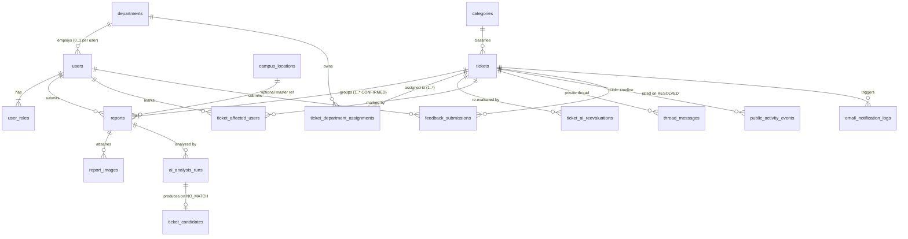

# KU Spot — Canonical Data Model & Schema Specification

This document is the single source of truth for **Enums**, **Record Numbering**, **PostgreSQL Schema**, **State Machines**, and **Metric Definitions** shared across `apps/api` (Go/PostgreSQL), `apps/ai` (Python), and `apps/web` (TypeScript).

---

## 1. Canonical Enums (Must Match Across DB, Go, Python & TypeScript)

| Enum | Canonical Values | Notes |
| --- | --- | --- |
| `Role` | `REPORTER`, `REVIEWER`, `DEPARTMENT_STAFF`, `ADMINISTRATOR` | `ADMINISTRATOR` is exclusive (`BR-ROLE-002`) |
| `ReportStatus` | `DRAFT`, `PENDING_REVIEW`, `CONFIRMED`, `REJECTED`, `CANCELLED` | `CONFIRMED`, `REJECTED`, `CANCELLED` are final workflow states |
| `TicketStatus` | `CONFIRMED`, `IN_PROGRESS`, `WAITING_INFORMATION`, `RESOLVED` | Active: first 3; Sole Final: `RESOLVED` |
| `Severity` | `CRITICAL`, `HIGH`, `MEDIUM`, `LOW` | Report count never auto-escalates (`BR-AI-013`) |
| `AIAnalysisStatus` | `PENDING`, `COMPLETED`, `FAILED` | `FAILED` never blocks submission/review (`BR-AI-020`) |
| `AIMatchDecision` | `MATCHED`, `NO_MATCH` | `NO_MATCH` produces unpublished `Ticket Candidate` |
| `CampusLocationType` | `BUILDING`, `COMMON_AREA`, `ROAD`, `ACTIVITY_PLAZA`, `SERVICE_POINT`, `LANDMARK` | KU Bangkhen master data |
| `PublicActivityType` | `TICKET_CONFIRMED`, `REPORT_ATTACHED`, `STATUS_CHANGED`, `DEPARTMENT_ADDED`, `DEPARTMENT_REMOVED`, `DEPARTMENT_ACTION`, `DEPARTMENT_COMPLETED`, `AUTO_RESOLVED` | Public timeline events only (never private thread text) |
| `MajorEmailEventType` | `CONFIRMED_NEW_TICKET`, `CONFIRMED_EXISTING_TICKET`, `WAITING_INFORMATION`, `RESOLVED` | Sent to Ticket Reporters only (`BR-NOT-003`..`005`) |
| `AuthProvider` | `GOOGLE` *(extensible via `AuthProvider` boundary, e.g., future `KU_ALL`)* | Initial MVP provider is Google OAuth 2.0 (`@ku.th`) (`BR-AUTH-001`, `BR-AUTH-004`) |

---

## 2. Record Numbering Convention

Matches `apps/web/src/lib/domain/numbers.ts`:

* Format: `<KIND>-<YYYY>-<NNNNN>` where `<YYYY>` is the 4-digit Gregorian year in timezone `Asia/Bangkok` and `<NNNNN>` is a 5-digit zero-padded sequence starting at `00001`.
* **Report Number:** `RPT-2026-00001` — assigned atomically on first transition to `PENDING_REVIEW` (`null` while `DRAFT`).
* **Ticket Number:** `TKT-2026-00001` — assigned atomically when Reviewer confirms a New Ticket (`CONFIRMED`).
* Backed by a transactional PostgreSQL counter table `record_sequences(kind, year, last_value)` using `INSERT ... ON CONFLICT DO UPDATE RETURNING last_value` to guarantee gap-safe concurrency without race conditions.

---

## 3. Entity Relationship Diagram

---

## 4. Logical PostgreSQL Schema

Entity primary keys use `UUID` (`gen_random_uuid()`), timestamps use `TIMESTAMPTZ` (UTC stored, rendered in `Asia/Bangkok` as needed), and schema changes are managed exclusively via Goose SQL migrations in `apps/api/migrations/`.

### 4.1 Identity & Master Data

* **`users`**
  * `id` UUID PK
  * `auth_provider` TEXT NOT NULL *(initial MVP value: `GOOGLE`; stored as extensible string to support future providers such as `KU_ALL`)*
  * `provider_subject_id` TEXT NOT NULL *(private, immutable; `UNIQUE(auth_provider, provider_subject_id)`)*
  * `username` TEXT NOT NULL *(public identity; mutable; case-insensitive unique index on `LOWER(username)`)*
  * `real_name` TEXT NOT NULL *(private)*
  * `email` TEXT NOT NULL *(private; used for Major Event Emails)*
  * `email_verified` BOOLEAN NOT NULL DEFAULT FALSE
  * `hosted_domain` TEXT NULL
  * `avatar_url` TEXT NULL *(private)*
  * `department_id` UUID NULL REFERENCES `departments(id)` *(max 1 department, `BR-ROLE-003`; MUST be NULL unless user has `DEPARTMENT_STAFF`)*
  * `is_active` BOOLEAN NOT NULL DEFAULT TRUE
  * `created_at` TIMESTAMPTZ NOT NULL, `updated_at` TIMESTAMPTZ NOT NULL
* **`user_roles`**
  * `user_id` UUID NOT NULL REFERENCES `users(id)` ON DELETE CASCADE
  * `role` TEXT NOT NULL (`REPORTER` | `REVIEWER` | `DEPARTMENT_STAFF` | `ADMINISTRATOR`)
  * `assigned_at` TIMESTAMPTZ NOT NULL, `assigned_by` UUID NULL REFERENCES `users(id)`
  * `PRIMARY KEY (user_id, role)`
  * The application and deferred constraints enforce at least one role per user at commit (`BR-ROLE-001`). If `ADMINISTRATOR` exists for `user_id`, the role count MUST be `1` and `users.department_id` MUST be `NULL` (`BR-ROLE-002`).
* **`sessions`**
  * `id` UUID PK, `token_hash` TEXT NOT NULL UNIQUE, `user_id` UUID NOT NULL REFERENCES `users(id)` ON DELETE CASCADE, `expires_at`, `revoked_at` (nullable), and `created_at`
* **`categories`**
  * `id` UUID PK, `name` TEXT NOT NULL, `description` TEXT NOT NULL DEFAULT `''`, `is_active` BOOLEAN NOT NULL DEFAULT TRUE, `created_at`, `updated_at`
  * `categories_name_key` is a case-insensitive unique index on `LOWER(name)` across active and disabled rows.
* **`departments`**
  * `id` UUID PK, `name` TEXT NOT NULL, `responsibility_scope` TEXT NOT NULL DEFAULT `''`, `is_active` BOOLEAN NOT NULL DEFAULT TRUE, `created_at`, `updated_at`
  * `departments_name_key` is a case-insensitive unique index on `LOWER(name)` across active and disabled rows.
* **`campus_locations`**
  * `id` UUID PK, `name` TEXT NOT NULL, `type` TEXT NOT NULL (`CampusLocationType`), `lat` DOUBLE PRECISION NOT NULL, `lng` DOUBLE PRECISION NOT NULL, `is_active` BOOLEAN NOT NULL DEFAULT TRUE, `created_at`, `updated_at`
  * `campus_locations_name_key` is a case-insensitive unique index on `LOWER(name)` across active and disabled rows.
  * `CHECK` constraints enforce the inclusive KU Bangkhen bounds (`lat BETWEEN 13.839 AND 13.858` and `lng BETWEEN 100.557 AND 100.580`).

### 4.2 Reports, Media & AI Triage

* **`reports`**
  * `id` UUID PK
  * `report_number` TEXT NULL UNIQUE *(assigned on first submit)*
  * `reporter_id` UUID NOT NULL REFERENCES `users(id)`
  * `status` TEXT NOT NULL (`ReportStatus`)
  * `version` INTEGER NOT NULL DEFAULT 1 *(increments on every `PENDING_REVIEW` edit)*
  * `description` TEXT NOT NULL DEFAULT `''`
  * `location_id` UUID NULL REFERENCES `campus_locations(id)`
  * `location_name` TEXT NULL, `location_detail_note` TEXT NULL
  * `lat` DOUBLE PRECISION NULL, `lng` DOUBLE PRECISION NULL *(mandatory on `status != 'DRAFT'`)*
  * `ai_generated_title` TEXT NULL *(latest AI Report Title or Reviewer override)*
  * `requested_target_ticket_id` UUID NULL REFERENCES `tickets(id)` *(advisory hint from `UC-RPT-005`)*
  * `ticket_id` UUID NULL REFERENCES `tickets(id)` *(NON-NULL **only** when `status = 'CONFIRMED'`, `BR-GEN-005`)*
  * `rejection_reason` TEXT NULL *(required when `status = 'REJECTED'`, `BR-REV-007`)*
  * `reviewed_by` UUID NULL REFERENCES `users(id)`, `reviewed_at` TIMESTAMPTZ NULL
  * `created_at` TIMESTAMPTZ NOT NULL, `submitted_at` TIMESTAMPTZ NULL, `updated_at` TIMESTAMPTZ NOT NULL, `cancelled_at` TIMESTAMPTZ NULL
  * *Indexes:* `(status, submitted_at DESC)` for Reviewer queue; `(reporter_id, created_at DESC)`; `(ticket_id)` where `ticket_id IS NOT NULL`; retention index on `(status, created_at)` and `(status, cancelled_at)`.
* **`report_images`** *(supports staged upload prior to Report creation + transactional binding)*
  * `id` UUID PK
  * `report_id` UUID NULL REFERENCES `reports(id)` ON DELETE CASCADE *(NULL while staged/unattached; set inside the same SQL transaction when creating/updating a Draft or submitting a Report)*
  * `uploaded_by` UUID NOT NULL REFERENCES `users(id)` *(owner checked before previewing staged images or binding to a Report)*
  * `storage_key` TEXT NOT NULL, `file_name` TEXT NOT NULL, `mime_type` TEXT NOT NULL (`image/png` | `image/jpeg`), `size_bytes` INTEGER NOT NULL CHECK (`size_bytes > 0 AND size_bytes <= 10485760`), `sort_order` SMALLINT NOT NULL DEFAULT 0, `exif_stripped` BOOLEAN NOT NULL DEFAULT TRUE
  * `expires_at` TIMESTAMPTZ NULL *(set to `created_at + 24 hours` while `report_id IS NULL`; cleared to `NULL` once attached to a Report)*
  * `created_at` TIMESTAMPTZ NOT NULL
  * *Indexes:* `(report_id, sort_order)` where `report_id IS NOT NULL`; partial cleanup index `(expires_at)` where `report_id IS NULL`.
  * *Access Control:* Staged images (`report_id IS NULL`) are readable ONLY by `uploaded_by`. Once attached, read visibility strictly inherits the parent Report's access rules (`DRAFT`/`CANCELLED`: owner only; `PENDING_REVIEW`/`REJECTED`: owner + active `REVIEWER`; `CONFIRMED`: Public).
* **`ai_analysis_runs`**
  * `id` UUID PK, `report_id` UUID NOT NULL REFERENCES `reports(id)` ON DELETE CASCADE
  * `report_version` INTEGER NOT NULL
  * `status` TEXT NOT NULL (`PENDING` | `COMPLETED` | `FAILED`)
  * `is_outdated` BOOLEAN NOT NULL DEFAULT FALSE
  * `generated_report_title` TEXT NULL
  * `suggested_category_id` UUID NULL REFERENCES `categories(id)`
  * `category_confidence` SMALLINT NULL CHECK (`category_confidence BETWEEN 0 AND 100`)
  * `alternative_category_id` UUID NULL REFERENCES `categories(id)`
  * `suggested_severity` TEXT NULL (`Severity`), `severity_rationale` TEXT NULL
  * `recommended_department_ids` JSONB NOT NULL DEFAULT `'[]'`
  * `match_decision` TEXT NULL (`MATCHED` | `NO_MATCH`)
  * `candidate_ticket_id` UUID NULL REFERENCES `tickets(id)`
  * `candidate_similarity` SMALLINT NULL CHECK (`candidate_similarity BETWEEN 0 AND 100`)
  * `similar_candidates` JSONB NOT NULL DEFAULT `'[]'` *(`[{ticketId, similarity}]` ranked desc)*
  * `model_version` TEXT NULL, `error_message` TEXT NULL
  * `created_at` TIMESTAMPTZ NOT NULL
* **`ticket_candidates`** *(unpublished draft created on AI `NO_MATCH`; never public, `BR-TKT-009`)*
  * `id` UUID PK, `ai_analysis_run_id` UUID NOT NULL UNIQUE REFERENCES `ai_analysis_runs(id)` ON DELETE CASCADE
  * `report_id` UUID NOT NULL REFERENCES `reports(id)` ON DELETE CASCADE
  * `suggested_title` TEXT NOT NULL, `suggested_summary` TEXT NOT NULL
  * `suggested_category_id` UUID NULL REFERENCES `categories(id)`, `suggested_severity` TEXT NULL
  * `recommended_department_ids` JSONB NOT NULL DEFAULT `'[]'`
  * `disposition` TEXT NOT NULL DEFAULT `'OPEN'` (`OPEN` | `PROMOTED` | `DISCARDED`)
  * `promoted_ticket_id` UUID NULL REFERENCES `tickets(id)`
  * `created_at` TIMESTAMPTZ NOT NULL, `updated_at` TIMESTAMPTZ NOT NULL

### 4.3 Tickets, Operations, Threads & Feedback

* **`tickets`**
  * `id` UUID PK, `ticket_number` TEXT NOT NULL UNIQUE
  * `title` TEXT NOT NULL, `summary` TEXT NOT NULL
  * `status` TEXT NOT NULL (`TicketStatus`)
  * `category_id` UUID NOT NULL REFERENCES `categories(id)`
  * `severity` TEXT NOT NULL (`Severity`)
  * `location_id` UUID NULL REFERENCES `campus_locations(id)`, `location_name` TEXT NOT NULL, `location_detail_note` TEXT NULL, `lat` DOUBLE PRECISION NOT NULL, `lng` DOUBLE PRECISION NOT NULL
  * `confirmed_by` UUID NOT NULL REFERENCES `users(id)`, `confirmed_at` TIMESTAMPTZ NOT NULL
  * `reevaluation_revision` INTEGER NOT NULL DEFAULT 0 *(monotonically incremented whenever a Confirmed Report is attached via `UC-REV-002` or corrected via `UC-REV-005`, preventing out-of-order/stale AI re-evaluation applies)*
  * `resolved_at` TIMESTAMPTZ NULL, `resolution_summary` TEXT NULL
  * `created_at` TIMESTAMPTZ NOT NULL, `updated_at` TIMESTAMPTZ NOT NULL
  * *Indexes:* `(status, confirmed_at DESC)` for Public Feed; `(category_id)`, `(severity)`, `(confirmed_at DESC)`.
* **`ticket_department_assignments`**
  * `ticket_id` UUID NOT NULL REFERENCES `tickets(id)` ON DELETE CASCADE
  * `department_id` UUID NOT NULL REFERENCES `departments(id)`
  * `assigned_by` UUID NOT NULL REFERENCES `users(id)`, `assigned_at` TIMESTAMPTZ NOT NULL
  * `is_completed` BOOLEAN NOT NULL DEFAULT FALSE
  * `completed_by` UUID NULL REFERENCES `users(id)`, `completed_at` TIMESTAMPTZ NULL, `completion_note` TEXT NULL
  * `PRIMARY KEY (ticket_id, department_id)`
  * *Invariants:* No `is_primary` column (`BR-TKT-011`); no `assigned_staff_id` column (`BR-TKT-012`); every Ticket has `≥ 1` row (`BR-TKT-010`).
  * *Concurrency Serialization:* Every transaction mutating Ticket status, assignments (`UC-REV-006`, re-evaluation apply), or department completion (`UC-DEP-003`) MUST acquire `SELECT ... FROM tickets WHERE id = $1 FOR UPDATE` before reading assignments/status and evaluating Auto-`RESOLVED` so concurrent completions/removals under PostgreSQL `READ COMMITTED` cannot miss the `RESOLVED` transition or emit duplicate `AUTO_RESOLVED` events.
* **`ticket_ai_reevaluations`** (`UC-AI-003`)
  * `id` UUID PK, `ticket_id` UUID NOT NULL REFERENCES `tickets(id)` ON DELETE CASCADE
  * `triggered_by_report_id` UUID NOT NULL REFERENCES `reports(id)`
  * `ticket_revision` INTEGER NOT NULL *(matches `tickets.reevaluation_revision` at trigger time)*
  * `status` TEXT NOT NULL (`PENDING` | `COMPLETED` | `FAILED`)
  * `is_outdated` BOOLEAN NOT NULL DEFAULT FALSE *(set `true` for prior unreviewed runs whenever `tickets.reevaluation_revision` increments)*
  * `suggested_title` TEXT NULL, `suggested_summary` TEXT NULL, `suggested_severity` TEXT NULL, `recommended_department_ids` JSONB NOT NULL DEFAULT `'[]'`, `rationale` TEXT NULL
  * `model_version` TEXT NULL, `error_message` TEXT NULL *(populated when `status = 'FAILED'`)*
  * `is_reviewed` BOOLEAN NOT NULL DEFAULT FALSE, `reviewed_by` UUID NULL REFERENCES `users(id)`, `reviewed_at` TIMESTAMPTZ NULL
  * `created_at` TIMESTAMPTZ NOT NULL
  * *Indexes:* `(ticket_id, ticket_revision DESC)` for latest re-evaluation lookup.
* **`ticket_affected_users`**
  * `ticket_id` UUID NOT NULL REFERENCES `tickets(id)` ON DELETE CASCADE
  * `user_id` UUID NOT NULL REFERENCES `users(id)` ON DELETE CASCADE
  * `created_at` TIMESTAMPTZ NOT NULL
  * `PRIMARY KEY (ticket_id, user_id)` (`BR-AFF-003`)
* **`thread_messages`** *(STRICTLY PRIVATE — `BR-THR-001`..`005`)*
  * `id` UUID PK, `ticket_id` UUID NOT NULL REFERENCES `tickets(id)` ON DELETE CASCADE
  * `author_id` UUID NOT NULL REFERENCES `users(id)`
  * `author_role` TEXT NOT NULL (`REVIEWER` | `DEPARTMENT_STAFF` | `REPORTER`)
  * `author_department_id` UUID NULL REFERENCES `departments(id)`
  * `body` TEXT NOT NULL
  * `created_at` TIMESTAMPTZ NOT NULL
* **`public_activity_events`** *(PUBLIC TIMELINE — `BR-AUD-001`..`002`)*
  * `id` UUID PK, `ticket_id` UUID NOT NULL REFERENCES `tickets(id)` ON DELETE CASCADE
  * `type` TEXT NOT NULL (`PublicActivityType`)
  * `actor_id` UUID NULL REFERENCES `users(id)` *(NULL when `actor_role = 'SYSTEM'`)*
  * `actor_role` TEXT NOT NULL (`Role` | `SYSTEM`)
  * `department_id` UUID NULL REFERENCES `departments(id)`
  * `old_status` TEXT NULL, `new_status` TEXT NULL
  * `summary` TEXT NOT NULL *(public-safe summary; never thread content)*
  * `evidence_images` JSONB NOT NULL DEFAULT `'[]'`
  * `created_at` TIMESTAMPTZ NOT NULL
* **`feedback_submissions`** (`BR-FBK-001`..`009`)
  * `id` UUID PK, `ticket_id` UUID NOT NULL REFERENCES `tickets(id)` ON DELETE CASCADE
  * `reporter_id` UUID NOT NULL REFERENCES `users(id)`
  * `ratings` JSONB NOT NULL *(map of dimension key → integer `1..5`; prototype keys: `speed`, `quality`, `communication`, `overall`)*
  * `comment` TEXT NULL
  * `created_at` TIMESTAMPTZ NOT NULL, `updated_at` TIMESTAMPTZ NOT NULL
  * `UNIQUE (ticket_id, reporter_id)` (`BR-FBK-003`)
* **`email_notification_logs`** & **`audit_logs`**
  * `email_notification_logs`: `id`, `event_type` (`MajorEmailEventType`), `ticket_id`, `report_id`, `recipient_user_id`, `recipient_email`, `subject`, `body_preview`, `status` (`SENT` | `FAILED`), `error_message`, `created_at`.
  * `audit_logs`: `id`, `entity_type` (`REPORT` | `TICKET` | `AI_RUN` | `USER` | `CATEGORY` | `DEPARTMENT` | `LOCATION` | `RETENTION`), `entity_id`, `action`, `actor_type` (`USER` | `SYSTEM` | `AI_SERVICE`), `actor_user_id` (required for `USER`), `actor_roles` JSONB, `department_id`, `details` JSONB, `created_at` (append-only; never updated or deleted).

---

## 5. State Machine Transition Tables

### 5.1 Report Transitions

| From | To | Actor | Preconditions / Side Effects |
| --- | --- | --- | --- |
| *(new)* | `DRAFT` | Reporter | Save partial/full form (`UC-RPT-001`) |
| `DRAFT` | `DRAFT` | Reporter (owner) | Update draft |
| *(new)* / `DRAFT` | `PENDING_REVIEW` | Reporter (owner) | Validate Description + Location/Map Point + 1–5 images; strip EXIF; assign `report_number`; `version = 1`; trigger `UC-AI-001` |
| `PENDING_REVIEW` | `PENDING_REVIEW` | Reporter (owner) | Edit before decision; `version++`; mark prior AI outdated; trigger `UC-AI-002` |
| `PENDING_REVIEW` | `CANCELLED` | Reporter (owner) | Set `cancelled_at`; remove from Reviewer queue; audit; purge after 30d |
| `PENDING_REVIEW` | `CONFIRMED` | Reviewer (≠ Reporter) | Latest `version` match; bind `ticket_id` (Active or New Ticket); audit; email Reporter |
| `PENDING_REVIEW` | `REJECTED` | Reviewer (≠ Reporter) | Latest `version` match; non-empty `rejection_reason`; no `ticket_id`; not public; audit |

### 5.2 Ticket Transitions

| From | To | Actor | Preconditions / Side Effects |
| --- | --- | --- | --- |
| *(Ticket Candidate)* | `CONFIRMED` | Reviewer (≠ Reporter) | ≥1 Responsible Dept, Category, Severity, Title/Summary; assign `ticket_number`; publish; email Reporter |
| `CONFIRMED` | `IN_PROGRESS` | Assigned Dept Staff (≠ Reporter) | `UC-TKT-001`; audit + public activity |
| `CONFIRMED` | `WAITING_INFORMATION` | Reviewer or Assigned Dept Staff (≠ Reporter) | Post private thread question (`UC-THR-001`); email Reporters |
| `IN_PROGRESS` | `WAITING_INFORMATION` | Reviewer or Assigned Dept Staff (≠ Reporter) | Post private thread question (`UC-TKT-002`); email Reporters |
| `IN_PROGRESS` | `RESOLVED` | **System** (`UC-TKT-004`) | All assigned departments complete (`UC-DEP-003` completion or `UC-REV-006` removal); set `resolved_at`; sole Final State; email Reporters; open Feedback |
| `WAITING_INFORMATION` | `IN_PROGRESS` | Assigned Dept Staff (≠ Reporter) | `UC-TKT-003`; audit + public activity |
| `WAITING_INFORMATION` | `RESOLVED` | **System** (`UC-TKT-004`) | Reviewer removes incomplete department(s) via `UC-REV-006` leaving all remaining assigned departments already complete (`BR-DEP-007`); set `resolved_at`; sole Final State; email Reporters; open Feedback |

> **Auto-Resolve Invariant (`BR-DEP-007`):** Direct department completion (`UC-DEP-003`) requires `status == 'IN_PROGRESS'`. However, removing an incomplete department (`UC-REV-006`) is allowed on any Active Ticket; whenever all remaining assigned departments are already complete after department replacement, the System immediately auto-transitions the Ticket to `RESOLVED` (including `WAITING_INFORMATION → RESOLVED`, or any active state in pure domain helpers).

---

## 6. Analytics & Metric Formulas (`BR-ANL-001`..`008`)

* **Ticket Count:** `COUNT(DISTINCT tickets.id)`
* **Report Count:** `COUNT(DISTINCT reports.id)` (scoped to `CONFIRMED` or all submitted depending on chart label — never conflated with Ticket Count)
* **Affected User Count:** `COUNT(*)` on `ticket_affected_users` (distinct `(ticket_id, user_id)` pairs; independent from Reporter Count)
* **Review Time:** `reports.reviewed_at - reports.submitted_at` (for decided reports)
* **Resolution Time:** `tickets.resolved_at - tickets.confirmed_at` (for `RESOLVED` tickets)
* **Total Lead Time:** `tickets.resolved_at - MIN(confirmed_reports.submitted_at)` (for `RESOLVED` tickets)
* **Ticket Aging:** `NOW() - tickets.confirmed_at` (for Active Tickets only)
* **Average Satisfaction:** Per-dimension mean and overall mean across `feedback_submissions` for `RESOLVED` tickets.
